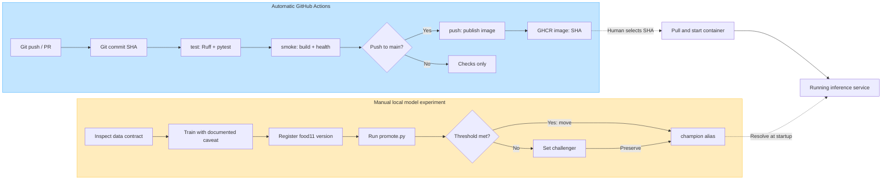

# Lab 5: CI/CD with GitHub Actions

## Scope and evidence

Implemented on 2026-11-06 in the existing Food-11 project, preserving Labs 1-4,
the original datasets, DVC pointer/cache, MLflow database/artifacts, and Docker
volume `mlflow-data`. The only dataset image added to Git is the 4,159-byte
`tests/fixtures/bread.jpg`, copied from mini validation `Bread/0_0.jpg`.

Local verification: 74 pytest tests passed; Ruff, actionlint, frozen dependency
sync, Python compilation, Docker build, Compose configuration, and the
`SKIP_MODEL=1` Docker smoke test passed. The latter returned health HTTP 200 and
prediction HTTP 503 even with an intentionally unreachable tracking URI.
Two upstream test-client deprecation warnings are non-failing. CPU-only PyTorch
is retained on Linux; the existing Windows CUDA training environment is retained.

Important data finding: the original mini dataset **does not pass** the new
no-cross-split-duplicates contract. It has 43 pre-existing duplicate violations.
This is an observed dataset problem, not a reason to weaken the validator or
silently rewrite DVC data. The two requested model runs are comparative lab
experiments on this unchanged historical dataset, not evidence of leakage-free
generalization. Neither candidate was promoted.

Both main-branch hosted workflows passed all three jobs. Their exact-SHA GHCR
images were published and pulled locally; the second image passed both isolated
health and real champion-model inference checks. PR #1 demonstrated a failing
unit test and skipped downstream jobs. The owner enabled branch protection;
GitHub then reported that failed revision as blocked. The correction passed both
required checks. Question 9 records the active rule and observed results.

## Question 1 — Unit-test isolation

A real startup model download would make a unit test depend on a laptop server,
network, credentials, registry aliases, artifact availability, and model/library
compatibility. A stopped server or expired credentials can fail a test with
perfectly correct application code; so can a moved alias or slow download.
`SKIP_MODEL=1` avoids all MLflow startup calls and allows injecting a module-level
`model`. Existing production-startup tests mock the loader instead, preserving
coverage of normal loading/retry behavior. Tests use a committed image or
temporary synthetic datasets, not DVC downloads or a GPU. Importing data code
does not execute the processing loop.

## Question 2 — What the fake proves

The inspected real MLflow model consumes float32 NumPy `[N,3,128,128]` and returns
11 raw logits. For example, one real output ranged from -2.700910 to 3.559371;
it was not a probability vector. The fake returns `[log(90), 0, ..., 0]`, so the
existing softmax gives Bread confidence `90/(90+10) = 0.90`.

The test checks multipart decoding, RGB/resizing/normalization, tensor shape and
dtype, category selection, softmax, response schema, and confidence bounds. It
does not measure real recognition accuracy, MLflow connectivity, GPU execution,
or model artifact compatibility. Separate live inference checks cover integration.

## Question 3 — Duplicate-data experiment

The `cross-split duplicates` check hashes complete file bytes with SHA-256.
The unchanged mini dataset initially reported 43 violations. Injecting a copy
of training `Bread/0_106.jpg` as evaluation `Bread/lab5_contract_duplicate.jpg`
raised this to 44. Removing only that injected file restored the original 43;
it would be false to claim that the original dataset then passed.

To also demonstrate pass/fail/pass, an isolated temporary copy omitted the 43
later cross-split duplicates. All six checks passed, an injected training-to-
evaluation duplicate failed, and removing it restored a pass. This temporary
copy was cleaned up; all 3,292 original mini files were verified byte-for-byte
unchanged. DVC status remained up to date. No DVC add/push was performed.

A corrupted image usually fails visibly during decoding. Train/test leakage
silently inflates evaluation accuracy, making a model appear to generalize when
it has seen the same example. Validation/evaluation overlap also compromises the
independence of model selection and final evaluation. Content hashing detects
exact byte duplicates, not all visually identical re-encodings or near-duplicates.

## Question 4 — Where real-data validation belongs

1. Immediately after DVC pull/preparation and before training on the machine
   holding the data; a failure should block new production training.
2. In a separate data-aware validation/release job on a secured self-hosted runner
   or an authenticated runner that downloads the exact DVC data version before
   accepting a new dataset/model release.

Ordinary cloud CI tests the validator with tiny temporary datasets. It does not
pretend to validate the unavailable full DVC dataset. The current historical
duplicate violations require an explicitly approved dataset remediation/version
and reevaluation before making production-quality claims.

## Question 5 — Job dependencies

`test -> smoke -> push` is enforced with `needs`. A failing test skips smoke and
therefore publication. Without `needs`, smoke could run in parallel and succeed
despite broken unit tests. Publication additionally requires a **push event to
main**; pull requests and other branches never publish images.

## Question 6 — Measured CI timing and caching

The initial implementation commit was `b9ef9ea96486d611725115419855cc3769640117`;
the empty comparison commit was `901ef00afed0c0c92d6ff87fcda01f993f185e76`.
Both runs completed successfully on 2026-11-06. These measurements use GitHub's
API timestamps (overall creation through completion, including scheduling).

| Measurement | [First run](https://github.com/paradoxghost/mlops-lab-1/actions/runs/42239866306) | [Second run](https://github.com/paradoxghost/mlops-lab-1/actions/runs/42241039326) |
| --- | --- | --- |
| Whole workflow | 6m 26s | 1m 49s |
| test job | 23s | 21s |
| Locked dependency installation | 7s | 6s |
| smoke job | 4m 51s | 54s |
| Docker build/load step | 4m 19s | 30s |
| push job | 59s | 23s |
| Image publication step | 35s | 7s |

The second workflow was 4m 37s (71.8%) faster. The largest improvement was the
Docker build: seven layers were reported as cached. Buildx uses GitHub Actions
cache scope `food11-image`, shared between smoke and publication. `setup-uv`
reported a cache miss on the first run and restored 311,137 bytes on the second;
its pruned cache did not preserve every downloaded wheel. Dependency installation
improved only one second, so the result should not be attributed mainly to uv.
Linux logs confirmed CPU-only `torch==2.14.0+cpu` and 74 passing tests without
DVC downloads, MLflow, or a GPU. Scheduling, extraction, image loading/export,
and cache upload still contribute to elapsed time.

## Question 7 — SHA tags versus latest

The workflow publishes `ghcr.io/paradoxghost/mlops-lab-1:<full-git-sha>`, connecting
an image release to reviewed source and allowing a precise rollback. If machine A
starts `latest` on Monday and machine B pulls the moved tag on Tuesday, they may
run different code under the same apparent name. Tags can still be overwritten;
an OCI digest gives the strongest content identity and should be recorded for
deployment. Publishing to GHCR is not deployment. The deployed code SHA and
MLflow model alias are independent release choices.

Verified published and locally pulled image:
`ghcr.io/paradoxghost/mlops-lab-1:901ef00afed0c0c92d6ff87fcda01f993f185e76`.
Its manifest digest is
`sha256:7fdf9abe07cd58e3b23f4c8cc92a9399a371b6a87f52e9f4c089e0c76d58d95d`.
Starting it with `SKIP_MODEL=1` returned HTTP 200 from health. Starting the same
image on the existing Compose network with `MLFLOW_TRACKING_URI=http://mlflow:5000`
loaded champion version 2 and returned a valid prediction. For the bread fixture,
the real model predicted Meat with confidence 0.4789030714523606; this integration
check demonstrates successful serving, not correct classification of that image.
Both temporary containers were removed without affecting persistent services.

## Question 8 — Token permissions

All jobs default to `contents: read`; only the main-push publication job receives
`packages: write`. Authentication uses the job's short-lived `GITHUB_TOKEN`,
never a hardcoded token. Checkout does not persist credentials. Third-party
actions are pinned to reviewed commit SHAs. A broadly writable compromised
step could alter repository code/workflows/releases or push malicious packages;
least privilege reduces the consequences. Untrusted PRs cannot enter the push
job, and no laptop/MLflow credentials are provided to CI.

## Question 9 — Branch protection exercise

Initial observation: main was unprotected and the repository had no rulesets.
The connected GitHub integration can create PRs but branch-protection API access
returned HTTP 403 `Resource not accessible by integration`; its repository admin
metadata does not grant the integration administration API permission.

[PR #1](https://github.com/paradoxghost/mlops-lab-1/pull/1) uses the separate
`lab5/ci-protection-exercise` branch. Commit
`3a14a315b5c707f471c9b917fdada9de0ce82e99` deliberately asserted that `0_12.jpg`
was Egg. The [pull-request workflow](https://github.com/paradoxghost/mlops-lab-1/actions/runs/42241205537)
reported one failed test and 74 passed; `smoke` and `push` were skipped.
Before protection, GitHub reported `mergeable: true` and
`mergeable_state: unstable`; red checks alone did not enforce a block. After the
owner enabled [Protect main](https://github.com/paradoxghost/mlops-lab-1/rules/26704118),
the **same failing revision** reported `mergeable_state: blocked` and main
reported `protected: true`. `mergeable: true` describes conflict-free Git content;
it does not override a policy-blocked merge. No broken code was merged or pushed
to main, and no failed merge was attempted to circumvent this result.

The verified active ruleset targets the default branch (`main`), requires a pull
request with zero required reviewer approvals, and requires GitHub Actions
`test` and `smoke` checks. The bypass list is empty. It also prevents deletion
and non-fast-forward pushes. The PR requirement was checked in the API after the
owner saved it; it was not inferred from the ruleset's name.

Correction commit `dd8582bf534dc025f039498134e8aae17fa53ee9` removed the deliberate
test. Its [PR workflow](https://github.com/paradoxghost/mlops-lab-1/actions/runs/42242597953)
passed `test` and `smoke`; `push` was skipped as required for PRs. Local tests
returned to 74 passed, zero failed. This report is delivered on that same PR,
with its final revision also subject to the required checks before a normal
merge. PR #1 retains the failure, correction, check history, and merge record.
No force push, history rewrite, or protection bypass is used.

For a team, these rules enforce shared checks at the merge boundary instead of
relying on everyone remembering to run local tests. They do not prove model
accuracy or validate the private DVC dataset; those remain separate gates.

## Question 10 — Actual promotion results

Both new runs used the existing ResNet18 training pipeline, mini dataset,
five epochs, batch size 32, seed 42, and the Windows NVIDIA GPU. They were logged
to the existing persistent Compose MLflow store and registered directly from
their new MLflow logged-model URIs, without reassigning champion during registration.

Champion before both comparisons: `food11` version **2**, originating deployment
run `85c2752abc6243c290c6babd295fc7a0`, with `test_accuracy = 0.7673357664233577`.
Its original Lab 2 training run was `6ecfb36f2ffd4ed19e49804c3c2ec39a`.
The run parameter `evaluation_samples = 1096` and `dataset = mini` identify the
actual evaluation split, not the full dataset's 3,347 evaluation images.

`se = sqrt(0.7673357664233577 * (1 - 0.7673357664233577) / 1096)`
`= 0.012762984943310537`.

The required improvement `2 * se = 0.025525969886621074`, or **2.552597 accuracy
percentage points**, gives threshold **0.7928617363099787 (79.286174%)**.

| Candidate | Run ID | Learning rate | Test accuracy | Decision | Aliases afterward |
| --- | --- | --- | --- | --- | --- |
| Version 3 | `adacef74c5104873b8fb38220ddc9ee0` | `1e-8` | `0.10218978102189781` | challenger | champion=2, challenger=3 |
| Version 4 | `9f7d8a4ae1f24517bfe088d06d7d576b` | `1e-4` | `0.7655109489051095` | challenger | champion=2, challenger=4 |

Both decisions and actual alias states were verified. The candidate model-version
tags record both accuracies, source runs, champion version, n, standard error,
threshold, and decision. The positive promotion path and equality boundary passed
mocked tests; no real candidate qualified, so no real promotion is claimed.
Already-champion requests are no-ops. Missing metrics/aliases, invalid versions,
unfinished runs, mismatched dataset/counts, and a concurrently changed champion
do not trigger a promotion. Network failures produce a clear nonzero exit.

This is the lecture's heuristic gate, not a formal paired significance test. Its
independent-trial assumptions and clean-holdout interpretation are weakened by
the discovered leakage; the numeric comparisons are faithfully reported, not
represented as a clean production validation.

## Question 11 — Automating promotion

One option is a local post-training script or a secured self-hosted runner with
access to the laptop MLflow server: validate data, train, register, evaluate the
gate, and record aliases. Another is a remotely hosted MLflow service such as
DagsHub or a secured cloud deployment, reachable from a protected workflow using
scoped secrets and approval/environment rules. Model training/promotion must not
run on untrusted PR events. Neither mechanism is silently enabled here.

## Question 12 — Complete release pipeline

Solid edges are ordered steps. Dashed edges are explicit manual handoffs or
runtime model resolution. GitHub automates tests/build/publication; deployment
and the local training/promotion experiment remain separate manual operations.



The model is loaded once; moving an alias requires restarting inference to pick
it up. A GHCR upload does not start/restart any laptop or production container.

## Reproduction commands (PowerShell, repository root)

```powershell
python -m uv sync --frozen
python -m uv run ruff check src tests
python -m uv run pytest -q
python -m uv run python src/food11/validate_data.py data/food11_processed_mini
docker build -t food11-api:ci .
docker run --rm -p 127.0.0.1:8002:8000 -e SKIP_MODEL=1 food11-api:ci
# In another terminal: curl.exe --fail http://127.0.0.1:8002/health
docker compose config --quiet
$env:MLFLOW_TRACKING_URI = 'http://127.0.0.1:5000'
python -m uv run python src/food11/promote.py --version 4
python -m uv run dvc status
git diff --check
git status
```

The real-data validator currently exits 1 for the documented pre-existing
duplicates. Never use `docker compose down -v` on this project's actual volume.
Repeating training or registration creates new experiments/versions; it is not
needed merely to rerun unit tests or the smoke test.
